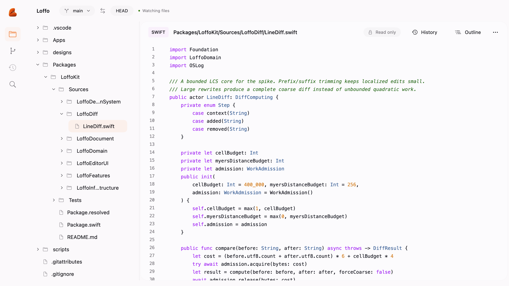
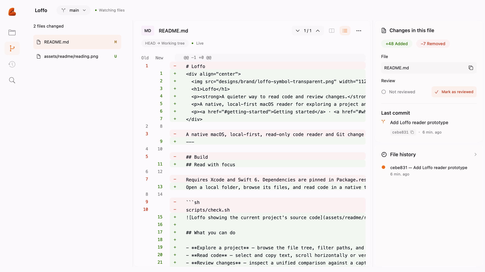

<div align="center">
  
  <h1>Loffo</h1>
  <p><strong>A quieter way to read code and review changes.</strong></p>
  <p>A native, local-first macOS reader for exploring a project and following its Git changes.</p>
  <p><a href="#getting-started">Getting started</a> · <a href="#what-you-can-do">Features</a> · <a href="#current-scope">Current scope</a> · <a href="#development">Development</a></p>
</div>

---

## Read with focus

Open a local folder, browse its files, and read code in a native text view. Loffo watches the active file for external changes while keeping the reading experience centered on your code.



## What you can do

- **Explore a project** — browse the file tree, filter paths, and resize or collapse the sidebar.
- **Read code** — select and copy text, scroll horizontally or vertically, and use syntax highlighting for supported languages.
- **Review changes** — inspect a unified comparison against a captured Git HEAD or an empty initial baseline, navigate change blocks, and see file-level additions and removals.
- **Follow local work** — refresh content after external file changes and inspect recent commits for the selected file.
- **Make it yours** — import supported color rules from a VS Code theme JSON file.



## Getting started

**Requirements:** macOS 14 or later, Xcode with Swift 6, and an installed Git for Git features. The first build downloads the pinned Swift package dependencies.

```bash
git clone https://github.com/tech-zjf/Loffo.git
cd Loffo
scripts/build-app.sh release
open build/Loffo.app
```

Choose **File → Open Folder…** and select a local project. Use the icons on the left to switch between files and changes. Loffo is a local, read-only prototype and does not require an account.

## Current scope

Loffo is an early prototype, not a finished release. It reads UTF-8 regular files within a 2 MiB limit, fewer than 30,000 lines, and a 20,000 UTF-16-unit line limit. Syntax highlighting supports TypeScript/JavaScript, Swift, Rust, Java and Python with varying coverage; other supported text can be read without highlighting.

The current comparison is **captured HEAD → working tree**, including added, untracked and deleted text files when a readable HEAD exists. Before the first commit, existing added and untracked text files are compared with an empty initial baseline. Some cases, including CRLF comparisons and files using unsupported Git attributes or filters, are limited or unavailable. Split diff, full-text search, editing and saving are not yet implemented. Performance, accessibility and visual fidelity are still being validated.

## Development

The project uses SwiftUI for the shell, AppKit/TextKit 2 for the reading surface, Tree-sitter for syntax parsing, and a bounded Git command runner for repository data. The Swift packages separate domain models, document loading, diff computation, infrastructure, UI and features.

Run the project checks:

```bash
scripts/check.sh
```

The app is built locally with an ad-hoc signature; distribution signing and notarization are not configured.
